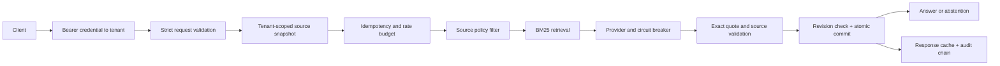

# Evidence Gateway

[](https://github.com/ManeeGit/evidence-gateway/actions/workflows/ci.yml)

**An auditable retrieval service that treats citations, tenant boundaries and evaluation failures as release-blocking contracts.**

Enterprise knowledge assistants need more than a successful model call. They need to prevent cross-tenant retrieval, invalidate stale evidence, reject fabricated citations, handle retries consistently and prove behavior against adversarial cases. Evidence Gateway implements those controls in a runnable, deliberately small system.

This is a **production-oriented reference implementation**, not a claim of a deployed enterprise service or a certified security boundary. The shipped provider is a deterministic, extractive BM25 baseline: it quotes source sentences rather than calling an LLM. There are no model downloads, API keys, paid services or external data requests in the demo or evaluation. The provider contract allows a separately reviewed generator adapter, but none is bundled and no generative-model quality is claimed.

## What is implemented

- Tenant identity comes from an authenticated bearer credential, never a request-body field. SQLite filters documents **before ranking**.
- Versioned, atomic ingestion rejects stale updates and rolls back conflicting batches. Content-derived tenant revisions bind answers to an exact source snapshot.
- Deterministic BM25 retrieval and exact-substring citation validation. Unknown, fabricated, duplicate or over-budget claims fail closed.
- Prompt-injection and email/SSN-shaped content heuristics, including source titles. These are narrow defense-in-depth filters, not comprehensive detectors.
- Persistent tenant rate budgets, revision-aware idempotency, and transactional response/audit writes. Concurrent duplicate computation may occur; a result is committed once.
- A thread-safe, process-local provider circuit breaker with a single half-open probe. Stale in-flight successes cannot close a newly opened circuit.
- Strict JSON HTTP boundary, explicit body/query/output limits, generic error responses and no raw request logging.
- A hash-linked audit log with HMAC query fingerprints; a local chain verifier. This is tamper-evident only with a trusted external checkpoint, not immutable storage.
- Unit/integration/security/concurrency tests, 25 synthetic gold-label evaluations, Python-version CI, package build and container smoke test.

## Quick start

Python 3.11+; no runtime package installation needed for the offline route:

```sh
git clone https://github.com/ManeeGit/evidence-gateway.git
cd evidence-gateway
export PYTHONPATH=src
python -m evidence_gateway demo
python -m unittest discover -s tests -v
python -m evidence_gateway evaluate --output reports/evaluation.json
```

The demo answers “How long are backup snapshots retained?” with:

```json
{
  "status": "answered",
  "answer": "Backup snapshots are retained for 35 days.",
  "citations": [{"document_id": "backup-policy", "version": 1,
                 "quote": "Backup snapshots are retained for 35 days."}]
}
```

The actual response also includes request ID, chunk ID, source title, provider, reason and index revision. All example company names, policies and sensitive-pattern fixtures are synthetic.

For an installed CLI and development tools:

```sh
python -m venv .venv
. .venv/bin/activate
pip install -e . -r requirements-dev.txt
make check
make lint
```

## Try the authenticated API locally

Use a trusted machine. These generated values stay in the current shell; do not commit them or put real credentials in terminal screenshots.

```sh
export PYTHONPATH=src
python -m evidence_gateway ingest examples/documents.json --db var/evidence.db
export EVIDENCE_AUDIT_KEY="$(python -c 'import secrets; print(secrets.token_hex(32))')"
export DEMO_TOKEN="$(python -c 'import secrets; print(secrets.token_hex(24))')"
export EVIDENCE_CREDENTIALS="$(python -c 'import json,os; print(json.dumps({os.environ["DEMO_TOKEN"]:"acme"}))')"
python -m evidence_gateway serve
```

In a second terminal, use the same locally generated DEMO_TOKEN (or run the server in the background in the original shell):

```sh
curl http://127.0.0.1:8080/v1/query \
  -H "Authorization: Bearer $DEMO_TOKEN" \
  -H 'Content-Type: application/json' \
  -d '{"question":"How long are backup snapshots retained?","request_id":"example-001","top_k":3}'
```

Use a new request ID for a new question or changed index. Exact retries return the stored response without consuming another rate-budget unit. A reused ID with different input or revision returns 409. A source change during generation also returns 409; retry it, using a new ID if the prior one already committed.

The development server binds only to 127.0.0.1. Do not expose it to the Internet. See [deployment and operations](docs/operations.md) for the optional Waitress container, TLS, credentials, backup and incident handling.

## Architecture



[Architecture and invariants](docs/architecture.md) · [Threat model](docs/threat-model.md) · [API contract](docs/api.md) · [Evaluation design](docs/evaluation.md) · [Operations](docs/operations.md) · [Validation record](docs/validation.md)

## Quality gates and evidence

```sh
PYTHONPATH=src python -m coverage run --source=evidence_gateway -m unittest discover -s tests -v
python -m coverage report --fail-under=80
PYTHONPATH=src python -m evidence_gateway evaluate --output reports/evaluation.json
python scripts/check_safety.py
python -m build
```

The synthetic evaluation requires every expected status, expected answer fragment, citation-document label and forbidden-content assertion to pass. The command exits nonzero on regression. Passing this small corpus is a **regression check**, not a real-world accuracy estimate. The repository's CI badge links to current observed results; it is not a claim that all future commits pass.

## Explicit limits and next steps

- English-oriented ASCII-token lexical retrieval has no stemming, semantic embeddings or reranker. Exact quotes guarantee provenance, not factual correctness, completeness or relevant interpretation.
- No live LLM adapter, streaming, tool execution, external URLs, agent actions or arbitrary document parsers. A provider is trusted Python code, not a sandbox; generator timeouts must be enforced by the adapter's transport.
- SQLite and full per-request tenant scans target modest local datasets on one host. There is no distributed rate limiter, multi-region failover, load-test SLO or HA claim.
- Static bearer credentials demonstrate tenant binding. An enterprise deployment needs managed identity, credential rotation and tenant membership lifecycle controls.
- Data and response caches are plaintext on disk; encrypt the storage layer and backups. Source deletion prevents serving stale cache entries but does not securely erase historical response text.
- No compliance certification, penetration test or production traffic validation is claimed. See the [production-readiness checklist](docs/operations.md#production-readiness-checklist).

## Repository map

```text
src/evidence_gateway/  API, retrieval, policy, provider, storage and evaluation
examples/              Synthetic multi-tenant corpus and gold evaluation labels
tests/                 Behavior, isolation, failure and concurrency regression tests
docs/                  Architecture decisions, threat model and runbooks
scripts/               Credential-pattern check and Docker smoke test
.github/workflows/     Python matrix, quality gates and container verification
```

MIT licensed. Contributions should add an evaluation case and regression test for changed behavior; see [CONTRIBUTING.md](CONTRIBUTING.md).
